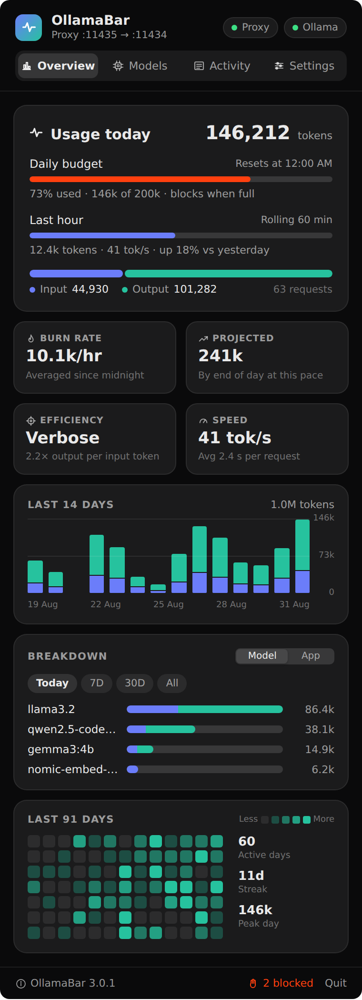
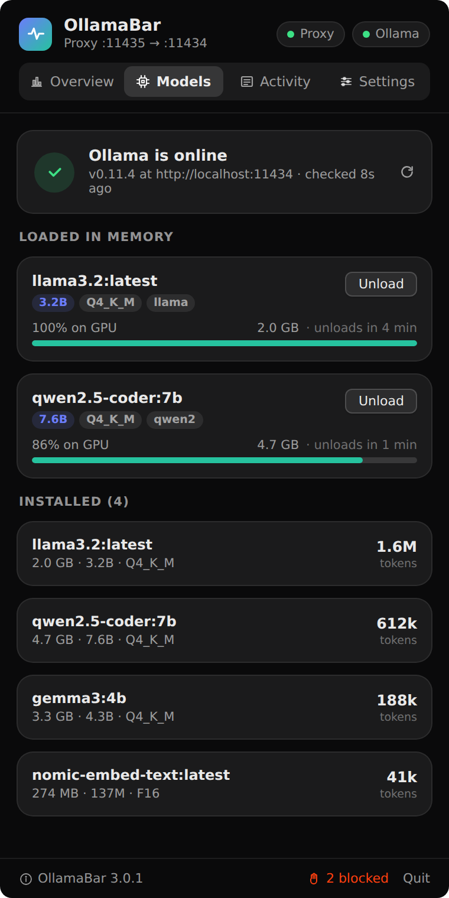
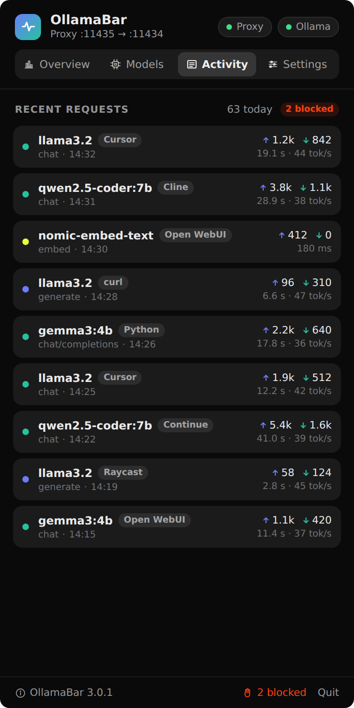
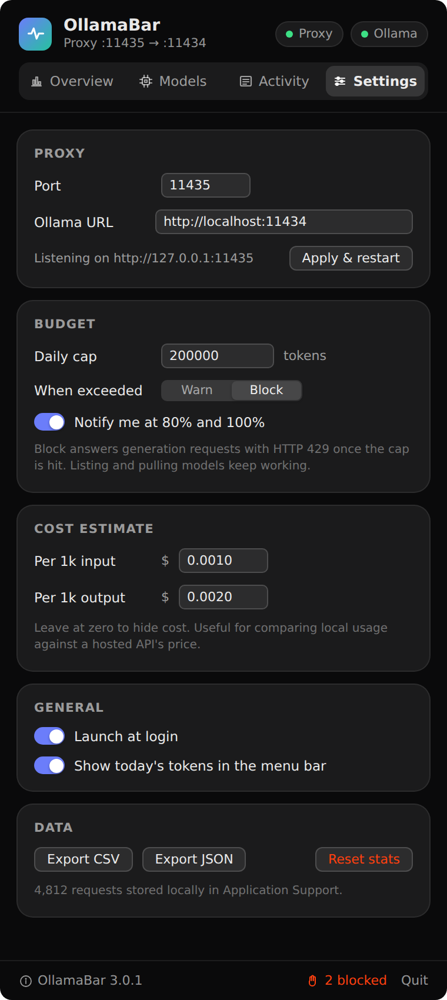
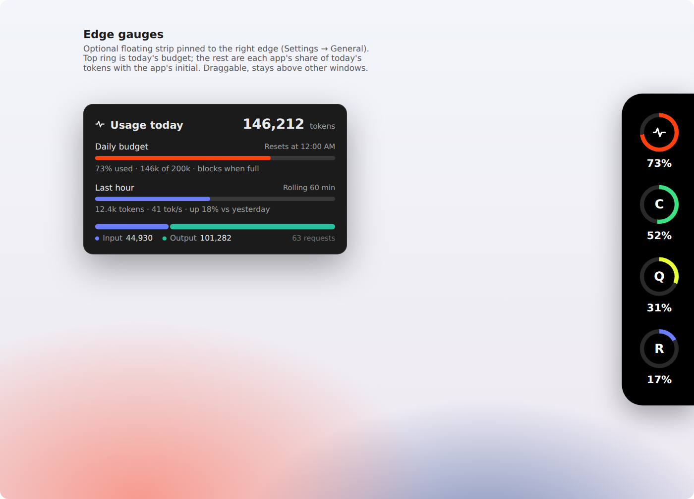
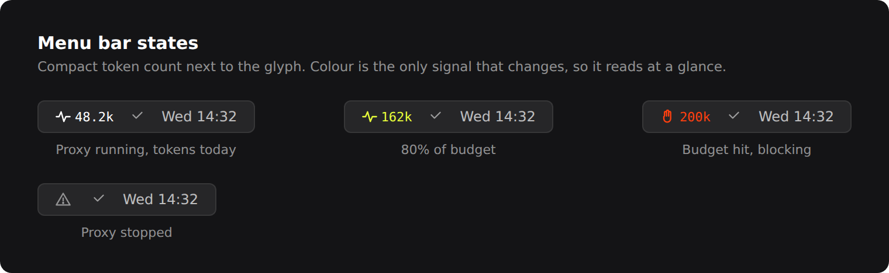

# OllamaBar

> A native Swift menu bar app for macOS that watches your local Ollama: live token counts, budgets, model status, and a floating gauge strip. It sits between your tools and Ollama as a transparent streaming proxy, built into the app. No Python, no runtime, nothing else to install.

[](https://github.com/hansraj316/OllamaBar/actions/workflows/swift.yml)
[](https://github.com/hansraj316/OllamaBar/releases/latest)
[](https://github.com/hansraj316/mission-control-openclaw)
[](https://github.com/hansraj316/OllamaBar)

<p align="center">
  
</p>

## How it works

Point any Ollama client at `http://127.0.0.1:11435` instead of `11434`. OllamaBar forwards each request to Ollama unchanged, streams the answer back as it is generated, and reads the token counts off the final chunk. Nothing leaves your machine.

The proxy is written in Swift on Apple's Network.framework (`NWListener`) and runs inside the app process. It starts when the app launches and stops when you quit.

```
Cursor / Open WebUI / curl ──▶ OllamaBar :11435 ──▶ Ollama :11434
                                  │
                                  └─ counts tokens, latency, budget
```

## What's new in 3.0

- **Real streaming proxy.** Tokens reach your client as Ollama produces them. Every method and path passes through, including the OpenAI-compatible `/v1` API, so model pickers and pulls keep working.
- **Four tabs.** Overview, Models, Activity, Settings replace the single scrolling list.
- **Models tab.** See what is loaded in memory, how much sits on the GPU, when it unloads, and evict it with one click.
- **Edge gauges.** An optional floating strip on the screen edge with ring gauges for your budget and each app's share of today's tokens.
- **Ink look.** Always-dark surface, one bright accent per bar with a "resets at" note, rings and bars that turn from mint to lime to hot as usage fills.

**Coming from 1.x?** The Python proxy is gone. Everything, proxy included, is native Swift now, and usage is stored in `~/Library/Application Support/OllamaBar/`. History from the 1.x file at `~/.ollama/ollamabar_usage.json` is not imported.

**3.0.1** fixes the packaging: the app icon is compiled into the bundle, the version string is back in the Info.plist, and the committed Xcode project matches the sources. Full history in [CHANGELOG.md](CHANGELOG.md).

## Screens

| Models | Activity | Settings |
|---|---|---|
|  |  |  |

**Edge gauges** — an optional floating strip on the screen edge, showing the daily budget and each app's share of today's tokens.



**Menu bar** — the glyph and colour change with proxy and budget state.



<sub>Rendered from the interface design. The numbers shown are sample data.</sub>

## Features

**Proxy**
- Transparent streaming proxy, any method and path, upstream status codes preserved.
- Token counting across all three APIs Ollama speaks: native `/api/generate` and `/api/chat`, OpenAI-compatible `/v1/chat/completions`, and Anthropic-compatible `/v1/messages`, so Claude Code pointed at Ollama is counted too.
- True generation speed from Ollama's own timer, so model loading doesn't drag tok/s down, plus per-request latency.
- Cold-load detection: see which requests waited for a model to load from disk, and how long.
- Prompt cache hit rate: how much of your prompt Ollama served from cache instead of re-processing.
- Daily token budget. *Warn* changes the menu bar colour. *Block* answers generation requests with HTTP 429 while model listing and pulling keep working.

**Overview**
- Today's total with input/output split, change vs yesterday, requests, and optional cost estimate.
- Daily budget bar with reset time, rolling last-hour bar, burn rate, projected end-of-day total, efficiency score, generation speed, cache hit rate, and cold loads.
- 14-day stacked trend chart.
- Breakdown by model or client app for Today, 7 days, 30 days, or all time.
- 91-day heatmap with active days, streak, and peak day.

**Models**
- Ollama online/offline and version, refreshed every 20 seconds.
- Loaded models with GPU share, size, and unload countdown, plus **Unload**.
- Installed models with size, parameters, quantisation, and all-time tokens.

**Activity**
- The last 60 requests with model, app, endpoint, tokens, duration, tok/s, cache hit rate, and a flag on cold loads.
- Labels each request with the app that sent it: Cursor, Claude Code, Open WebUI, Cline, Continue, Zed, Aider, Raycast, the Ollama CLI, OpenAI and Anthropic SDKs, curl, and scripts in Python, Node, or Go.

**App**
- Edge gauges strip, launch at login, budget notifications at 80% and 100%, CSV/JSON export, settings that apply without relaunching.

## Installation

Download **[OllamaBar.zip from v3.0.1](https://github.com/hansraj316/OllamaBar/releases/tag/v3.0.1)** (the [latest release](https://github.com/hansraj316/OllamaBar/releases/latest) is always current).

```bash
# 1. Unzip and install
unzip ~/Downloads/OllamaBar.zip -d /Applications

# 2. Clear the quarantine flag (the build is ad-hoc signed, not notarised)
xattr -cr /Applications/OllamaBar.app

# 3. Launch
open /Applications/OllamaBar.app
```

A waveform icon appears in the menu bar. Requires macOS 14 or later and a running Ollama (`ollama serve`).

Prefer to build it yourself? See [Development](#development) — it is one `xcodegen generate` and one `xcodebuild` away.

## Usage

Change your client's Ollama URL from `http://127.0.0.1:11434` to `http://127.0.0.1:11435`. For OpenAI-compatible clients, use `http://127.0.0.1:11435/v1`.

```bash
# Native API
curl http://127.0.0.1:11435/api/chat \
  -d '{"model":"llama3.2","messages":[{"role":"user","content":"hi"}]}'

# Anthropic-compatible API, as used by Claude Code (counted too)
curl http://127.0.0.1:11435/v1/messages \
  -d '{"model":"llama3.2","max_tokens":256,"messages":[{"role":"user","content":"hi"}]}'

# OpenAI-compatible API (counted too)
curl http://127.0.0.1:11435/v1/chat/completions \
  -d '{"model":"llama3.2","messages":[{"role":"user","content":"hi"}],"stream":true,"stream_options":{"include_usage":true}}'

# Management endpoints pass straight through
curl http://127.0.0.1:11435/api/tags
```

**Budget.** Settings → Budget. Set a daily cap in tokens and choose *Warn* or *Block*. Turn on notifications to get a system alert at 80% and 100%.

**Edge gauges.** Settings → General → Edge gauges. A black strip appears on the right edge of the screen. The top ring is today's budget; the rings below are each app's share of today's tokens. Drag it anywhere.

**Export.** Settings → Data → Export CSV or JSON. Usage lives in `~/Library/Application Support/OllamaBar/`.

## Development

Built with Swift 5.9, SwiftUI, Swift Charts, Network.framework and the Observation framework. No third-party dependencies.

Requirements: Xcode 16+, macOS 14+, [xcodegen](https://github.com/yonaskolb/XcodeGen).

```bash
# Generate the Xcode project
xcodegen generate

# Build
xcodebuild -scheme OllamaBar -configuration Debug build

# Run tests
xcodebuild test -scheme OllamaBar -destination 'platform=macOS,arch=arm64'

# Run a single test class
xcodebuild test -scheme OllamaBar -destination 'platform=macOS,arch=arm64' \
  -only-testing:OllamaBarTests/UsageStoreTests
```

Architecture notes live in [CLAUDE.md](CLAUDE.md).

### Releasing

Push a version tag and the [Release workflow](.github/workflows/release.yml) builds the app on a macOS runner, ad-hoc signs it, zips it, and publishes a GitHub Release with the matching `CHANGELOG.md` section as notes.

```bash
git tag v3.0.0
git push origin v3.0.0
```

## The Mission

OllamaBar is an observability pillar of the **Indian Avengers** organisation. It provides the **Token Efficiency & Budget Enforcement** required to scale a multi-agent "GitHub Factory" toward the **$1,000,000 revenue goal**. Every agent, from **Anusandhan (The Sentinel)** to **Parmanu (Engineering Commander)**, uses OllamaBar to keep token usage optimised and operational costs locked.

## Claude Code / OpenClaw Integration

OllamaBar pairs with the [Mission Control dashboard](https://github.com/hansraj316/mission-control-openclaw) for full-stack observability across the Indian Avengers org:

- **OllamaBar** monitors local Ollama LLM usage (token budget, per-model breakdown, model residency).
- **Mission Control** monitors the 25-agent org (cron jobs, agent activity, security telemetry).

Agents running via OpenClaw that use local models (Aditya, Dhruva) route through `http://127.0.0.1:11435` for token tracking.

## License

MIT
